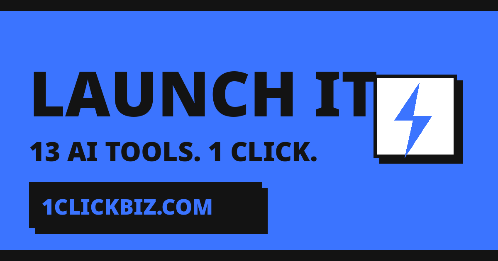

# 1 Click Business

**Launch a real business in one sitting.** 16 AI tools that take you from "no idea" to a named, branded business with a live website, ads, social posts, funding leads and a customer CRM — each tool feeds the next.

## What you get

- **Idea → Launch pipeline** — answer 8 questions once; every tool runs in order with one shared brand
- **AI business advisor (Solomon™)** — knows your plan, pricing, site and leads; rewrites any asset on command
- **Free hosted customer sites** — live at `/sites/your-name`, on your domain, or as an HTML5 download
- **Built-in lead CRM** — sites collect leads straight into your dashboard
- **13-in-one All-Access plan** — $99/mo, 500 AI generations, save $115/mo vs. buying separately

## Stack

Bun · React 19 · Hono · Firebase (Auth + Firestore) · Autumn + Stripe billing · Gemini AI gateway · Vite · Tailwind. Neo-brutalist design system (electric blue / ink / mint — see `design.md`). Web, Expo mobile and Electron desktop packages in `/packages`.

## Run it

1. `bun install`
2. Copy `.env.example` → `.env` and fill in database, AI gateway, auth and billing credentials
3. `bun run db:push` then `bun run dev`
4. Production billing, publishing and deferred email: see `LAUNCH.md`

## Repo layout

- `packages/web` — the app: API (`src/api`), storefront + dashboard UI (`src/web`), viewers for each tool's output
- `packages/mobile`, `packages/desktop` — Expo / Electron clients
- `public/images` — branded SVG art pack (hero, stage tiles, tool posters, funnel art)
- `design.md` — the design system: tokens, type, shape, motion

Built by [Daniel Collins](https://github.com/danielcollins104).
